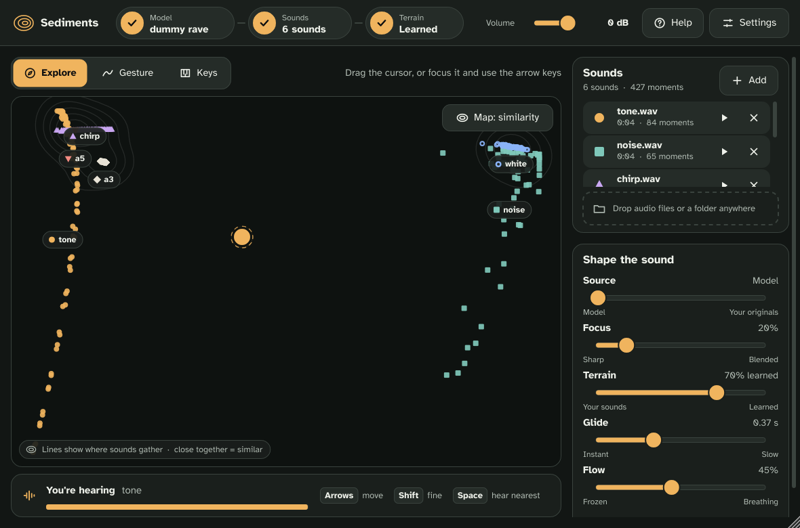

# Sediments (prototype v0.8)

[](https://github.com/antoinensl/LPF_Sediments/actions/workflows/build.yml)

An instrument plugin for Reaper (VST3, plus AU on macOS) that sits between two approaches: the **latent terrain** (inspired by [nn.terrain](https://jasper-zheng.github.io/nn_terrain/)) and **concatenative synthesis** (in the spirit of CataRT).

Your recordings settle on a 2D map, with similar sounds close together. You move across it with the mouse, with recorded gestures or from a MIDI keyboard, and the sound is either reinvented by a RAVE neural model, rebuilt from grains of your original recordings, or a blend of both. Everything happens inside Reaper, no Max needed.

A [Life Pass Filter](https://lifepassfilter.com) project. Fonts: Atkinson Hyperlegible and OpenDyslexic (SIL Open Font License).



## Download a ready-made build (Windows and macOS)

GitHub builds the plugin automatically on every update, so you don't need Visual Studio or libtorch.

1. On the repository page, in the right-hand column, open **Releases** and pick the latest version.
2. Download `Sediments-Windows.zip` or `Sediments-macOS.zip` (Apple Silicon Mac: M1, M2, M3…, macOS 14 Sonoma or later).
3. Unzip it and follow `README.txt`: on Windows, double-click `INSTALL.bat`; on macOS, right-click `Install.command` and choose **Open**.

The very latest work-in-progress builds are also in the **Actions** tab (open the latest successful run, then **Artifacts** at the bottom of the page). They are kept for 14 days, and you need to be signed in to GitHub to download them.

On macOS the plugin is not signed by Apple (official signing costs 99 € a year). The installer removes the quarantine flag so macOS accepts to load it on your own computer.

## How it works

1. **Your sounds are cut into short moments.** Each moment becomes a mark on the map. Silent moments (below −60 dBFS) are skipped.
2. **The map** puts similar moments close together: as heard by the model when one is loaded, otherwise by their audio descriptors. You can also choose explicit axes (see *Map layout*).
3. **The sound** at the cursor comes from one of two sources, or a blend:
   - **The model (RAVE)**: the moments around the cursor are blended in the model's latent space and decoded. Optionally, a **learned terrain** (a small neural network trained in the background in a few seconds after every change of sounds) fills in the space between and around your sounds with new material. This is the nn.terrain approach.
   - **Your originals**: your recordings themselves are replayed in small windowed grains picked around the cursor (concatenative synthesis).

You can drop wav, aif, flac, mp3 or ogg files, a whole folder, or a `.ts` model anywhere on the window.

### Without a model

Choose **Play without a model** on the welcome screen (or from the Model step menu). Files are analysed into units of about 23 ms described by four properties: **pitch** (with a clarity index), **brightness** (spectral centroid), **noisiness** (spectral flatness) and **loudness**. Nothing to download, analysis is almost instant, and latency drops to about 30 ms. The learned terrain and the Terrain control only apply with a model.

### Map layout

The **Map** button (top right of the map) sets what the axes mean: **Similarity** (sounds that are alike sit together), or one property left to right and another bottom to top: **Pitch**, **Brightness**, **Noisiness**, **Loudness**. For example pitch × brightness, as in CataRT. The chosen axes are saved with the project and also work with a model.

## Controls

| Control | Effect |
|---|---|
| **X / Y** | Position on the map. These are plugin parameters: automate them, modulate them (LFO, envelopes, MIDI learn in Reaper). |
| **Source** | With a model: from **Model** (the model replays everything) to **Your originals** (grains of your recordings). |
| **Focus** | How far around the cursor sounds are blended or grains are picked. Low: stick to the nearest moment. High: smooth blends of neighbouring moments. |
| **Terrain** | With a model: from **Your sounds** (blend of the nearby moments) to **Learned** (the learned terrain). |
| **Glide** | Smoothing of movements, from instant to several seconds. With MIDI notes it acts as a timbre portamento. |
| **Flow** | Lets each sound keep the motion it had in the recording (beats, breath, grain) even when the cursor is still. 0 = frozen snapshot, 1 = fully follows the original motion. |
| **Grain size** | Originals only: length of the grains, from 10 ms (grainy) to 1 s (real excerpts). |
| **More → Flow speed** | Speed of the Flow playback (1× = original speed). |
| **More → Input** | Lets the track's input through. |
| **Volume** | Output level (top bar). |

Double-click any slider to reset it.

## Playing: Explore, Gesture, Keys

The three tabs (shortcuts **1**, **2**, **3**) are three ways of moving across the map.

### Explore

Drag the cursor, or focus it and use the arrow keys (Shift for fine steps). The **You're hearing** strip says in plain words which sounds make up what you hear, with their proportions. Shift-click a mark (or press Space) to hear the original moment.

### Gesture (recorded paths)

1. Click **Record** (or press **R**). The map gets a red outline.
2. Draw a gesture on the map: its shape and its timing are recorded.
3. When you release, the gesture loops.

| Option | Effect |
|---|---|
| **Free / 1 beat … 4 bars** | Free: recorded duration × Speed. Otherwise the loop is stretched to last exactly that long, locked to Reaper's tempo and play position. |
| **Forward / Backward / Back and forth** | Playback direction. |
| **Follow the cursor** | The gesture keeps its shape but starts from the X/Y position, or from the zone of the MIDI note being played. |
| **Speed** | Speed in Free mode (greyed out when locked to the tempo). |

The gesture is saved with the Reaper project.

### Keys (MIDI notes)

Turn on **Play with MIDI notes** to make the plugin listen to the track's MIDI.

- The map is split automatically into **12 zones**, one per note name: **C at the top**, then clockwise. The octave doesn't matter: C2 and C5 play the same zone.
- Each note **triggers** the sound (Attack / Release envelope) and **velocity** sets its level.
- **Monophonic**: the last note wins. Played legato, the sound glides to the new zone without retriggering.
- **Spray**: each note picks a random point around the zone's centre, so two hits of the same note never sound exactly alike (an idea borrowed from Coalescence).
- With a gesture set to **Follow the cursor**, each note replays the gesture from its zone.

To play: arm the plugin's track for recording and pick your MIDI keyboard as input, or write notes in a MIDI item on the track. The on-screen keyboard plays the zones too (and turns MIDI notes on automatically).

Outside MIDI mode the sound is continuous (a drone) and follows X/Y.

## Display and accessibility (Settings)

These settings are saved on your computer, for every project.

| Setting | Choices |
|---|---|
| **Theme** | Dusk (dark), Daylight (light), High contrast, Night (dim and warm, for late studio sessions). |
| **Sound colours** | Standard, Red-green safe (Okabe–Ito palette, for protanopia and deuteranopia), Blue-yellow safe (for tritanopia). Shades are adjusted automatically so they always stand out on the map. |
| **Colour of one sound** | Click a sound's swatch in the list: palette or any colour. Saved with the project. |
| **Accent colour** | Colour of buttons and highlights. The contrast with the panels is shown; when it is too low for text, **Make it readable** suggests the nearest readable shade. |
| **Font** | Atkinson Hyperlegible (default, designed to keep look-alike letters apart), the system font, or OpenDyslexic. |
| **Text size** | 100, 125 or 150 %. The whole window grows with the text, so nothing gets cut off. |
| **Letter spacing** | Normal, Wide, Wider. |
| **Shapes as well as colours** | Each sound gets its own marker shape (circle, square, triangle…), so colour is never the only clue. |
| **Calm motion** | No animation: the cursor jumps straight to its position. |
| **Announce what you hear** | Screen readers announce which sounds are in the mix as you move. |

Everything also works from the keyboard: **Tab** moves between controls, **arrows** move the cursor (Shift for fine steps), **Space** plays the nearest original moment, **R** records a gesture, **1 / 2 / 3** switch tabs, **?** opens the help, **Esc** closes a panel. In Reaper, if a shortcut is caught by Reaper instead of the plugin, enable **Send all keyboard input to plug-in** in the **+** menu of the FX window.

## RAVE models

To use a model you need a RAVE model exported for nn~ (a `.ts` file). Pre-trained models are available, for example, from the [Intelligent Instruments Lab collection on Hugging Face](https://huggingface.co/Intelligent-Instruments-Lab/rave-models) and through the RAVE GitHub repository.

- Prefer **streaming** exports. Non-streaming models also work, with artefacts at frame boundaries.
- To train a model on your own sounds, use the official RAVE training script once, offline, on a machine with a GPU, then export it with `--streaming`.
- The plugin reads the model's sample rate when it is exposed, or from the file name (`r48000`, `sr44100`…). Otherwise it assumes 44.1 kHz.

## Building on Windows (step by step)

Only if you want to build it yourself. You install two things once, then double-click a script.

### 1. Install Visual Studio (once, about 30 min)

1. Download **Visual Studio Community** (free) from <https://visualstudio.microsoft.com/>.
2. During installation, tick **Desktop development with C++**, then click Install. The download is several GB.
3. You never need to open Visual Studio: the script uses it on its own.

If the script later says Git is missing, install it from <https://git-scm.com/download/win> with the default options.

### 2. Download libtorch (once)

1. Go to <https://pytorch.org/get-started/locally/>.
2. In the table, choose **Stable**, **Windows**, **LibTorch**, **C++/Java**, **CPU**.
3. Download the **Release** link (not the Debug one).
4. Unzip it directly into `C:\`. You should get `C:\libtorch\lib`, `C:\libtorch\include`, etc.

### 3. Build the plugin

1. Get the project: on the GitHub page, green **Code** button, then **Download ZIP**. Unzip it into a short path, for example `C:\Sediments`.
2. Double-click **`BUILD.bat`**.
3. Wait: 5 to 15 minutes the first time, less afterwards.
4. Near the end, the script asks whether it may add libtorch to your Path. Answer **Y**: this is what lets Reaper find libtorch.

When it's done, a **`Plugin_for_Reaper`** folder contains `Sediments.vst3`.

If Windows shows "Windows protected your PC", click **More info**, then **Run anyway**. If a step fails, the script explains it in red.

### 4. Add the plugin to Reaper

1. **Quit and reopen Reaper**, so it picks up the Path change.
2. *Options → Preferences → Plug-ins → VST*.
3. Next to "VST plug-in paths", click **Add…** and choose the `Plugin_for_Reaper` folder.
4. Click **Re-scan**, then OK.
5. On a track: **FX** button, then search for "Sediments".

If Reaper says the plugin can't be loaded, it is almost always the Path: make sure Reaper was fully closed and reopened, and restart the computer if needed.

To try it without Reaper, run `build\Sediments_artefacts\Release\Standalone\Sediments.exe`.

### From the command line

```powershell
cmake -B build -A x64 -DCMAKE_PREFIX_PATH=C:/libtorch
cmake --build build --config Release
```

On macOS (Apple Silicon), with the macOS arm64 libtorch unzipped next to the project:

```bash
cmake -B build -DCMAKE_BUILD_TYPE=Release -DCMAKE_PREFIX_PATH=$PWD/libtorch -DCMAKE_OSX_DEPLOYMENT_TARGET=14.0
cmake --build build --parallel
```

## Releases

The workflow in `.github/workflows/build.yml` builds Windows and macOS on every push. When the version in `CMakeLists.txt` (`project(Sediments VERSION x.y.z)`) has no Release yet, it publishes one with both zips.

## Known limitations

- **Latency**: with a model, about two frames, i.e. ~90 to 120 ms with a 2048 ratio, including between a MIDI note and the sound. Fine for textures, gestures and slow phrases, not for tight percussive playing. Tempo-locked gestures stay in sync: the plugin compensates for its look-ahead. Originals alone: about 30 ms.
- **Monophonic**: one voice at a time (one position on the map).
- **Memory**: to replay the originals, files are kept in memory (about 23 MB per minute of 48 kHz stereo, 20 minutes at most per file).
- **Pitch axis**: moments without a clear pitch (noises, textures) are placed in the middle of the Pitch axis.
- **Layout**: it is recomputed whenever files are added or removed, so marks move around and the learned terrain is retrained (a few seconds).
- **Learned terrain**: training shares the CPU with synthesis. It is throttled to avoid dropouts, but on a modest machine wait for it to finish before recording.
- **CPU only**: everything runs on the CPU, with the model loaded twice (one instance for encoding, one for synthesis).
- **Sessions**: the state is saved in the Reaper project (model path, file list, settings). When the project reopens, files are analysed again, which takes a few seconds.
- **macOS**: Apple Silicon and macOS 14 or later only (the minimum of current libtorch builds).

## Roadmap

1. **Live input**: record guitar takes straight into the corpus, and let the guitar itself drive the position on the map.
2. **Polyphony**: chords, with one decoder per voice.
3. **Map editing**: move groups of marks by hand to compose your own sound geography.

## Code structure

| File | Role |
|---|---|
| `Source/RaveModel.*` | TorchScript loading, `encode` / `decode` (the only file that includes libtorch besides the learned terrain). |
| `Source/Corpus.*` | Corpus of frames, PCA or descriptor-axis layout, MIDI zones, blend of nearby frames (Gaussian interpolation). |
| `Source/Analysis.*` | Audio descriptors: pitch (McLeod pitch method), brightness, noisiness, loudness. |
| `Source/GrainPlayer.*` | Concatenative playback of the originals: windowed grains picked around the cursor, Flow. |
| `Source/LearnedTerrain.*` | Learned terrain: coordinate network (Fourier features + MLP) trained on the CPU. |
| `Source/LatentEngine.*` | Import thread (model, files), synthesis thread (terrain → RAVE and/or grains → resampling → FIFO), lock-free reading on the audio thread. |
| `Source/PluginProcessor.*` | Parameters, MIDI, transport, audio routing, saved state. |
| `Source/PluginEditor.*` | Interface assembly, scaling (text size), keyboard shortcuts, drag and drop. |
| `Source/ui/UiCore.*` | Themes, colour palettes, contrast, bundled fonts, display settings, icons, button and slider drawing. |
| `Source/ui/Widgets.*` | Labelled sliders, segmented choices, checkboxes with descriptions. |
| `Source/ui/MapView.*` | The map: marks, contour lines, MIDI zones, gesture, keyboard-accessible cursor. |
| `Source/ui/Panels.*` | Top bar, tabs, "You're hearing", Gesture and Keys panels, sound list, sound controls, welcome screen, map layout, settings, help. |
| `Resources/fonts/` | Atkinson Hyperlegible and OpenDyslexic (SIL Open Font License, OFL files included). |
| `packaging/` | Installers and read-me files shipped in the release zips. |
| `tools/` | Test tools: fake RAVE model, command-line renderer, interface screenshots. |

To build the test tools: `-DLT_BUILD_CLI=ON` and `-DLT_BUILD_SNAPSHOT=ON`. Example: `sediments_cli model.ts out.wav a.wav b.wav` renders a 10-second circular walk across the map (`none` instead of a model file plays the originals without a model).
